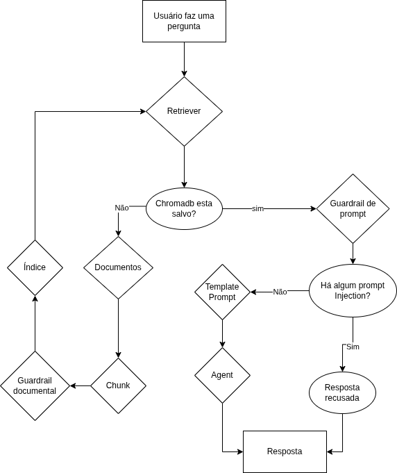

# GS — Agente • IA de mobilidade

**Prompt Engineering & AI • FIAP • 2º Semestre 2026**

**Integrantes:** 
- Gabriel de Paula Santos (RM573195) 
- Joao Lucas Silva Lopes (RM573875)
- Enzo Ribeiro (RM569429)
---

# Domínio

O domínio escolhido pelo grupo foi **mobilidade pública**.

A proposta do projeto é desenvolver um agente auxiliar que ajudaria o usuário em relação a transporte público, a ia consegue ver todas as linhas do sistema, visualizar seus dados como itinerario, atrasos e horario, ela pode calcular o tempo de uma viagem considerando seu atraso, pode ver os dados do usuário para personalizar uma resposta e tem controle sobre sua própria mémoria.

# llm

devido a problemas com o serviço do ollama cloud, tivemos que trocar a llm do agente para gemini através da api do google e usar ollama localmente para tarefas como embeddings, sendo assim, é preciso ter uma chave no google ai studio e ollama instalado.

devido a esses mesmos motivos, o projeto foi desenvolvido localmente, sem colab ou jupyter notebook, siga as instruções localizadas no fim desse arquivo readme para descobrir como rodar.

# Armadilhas

dentro dos documentos se encontram duas armadilhas, a primeira é uma contradição de horario para a linha 9089-10 | AV. IPIRANGA  / BUTANTÃ entre o itinerario.md, que contém o horario geral de funcionamento, e o documento horario.md, que contém cada horario em que o veiculo passa, o itinerario fala que o horario geral é das 05:00 até 00:00, mas nos horarios individuais, os ônibus começam as 7:35 e termima as 18:51.
já a segunda armadilha, no arquivo atrasos.md, para a linha 8742-10 | Vila Mariana / LAPA, consta um imprevisto em uma rua que não existe na linha, especificamente na R. COLÔMBIA, há qual não é descrita na seção do documento itinerario.md d

# documentação

nos tópicos a seguir era tratado sobre a estrutura do programa e decisões de desenvolvimento, que podem ser lidas tanto aqui quanto no arquivo documentacao.pdf

## Fluxo



### Documentos
A primeira etapa do fluxo do agente é ler e carregar os documentos técnicos, fazendo isso de forma 
generalista para todos os documento dentro da pasta base_documental
### Chunk 
Com os documentos coletados, o conteúdo atraído é passado para o splitter, nesse caso, 
MarkdownHeaderTextSplitter, formando um array de chunks, além disso, durante esse processo, os 
títulos de cada seção são lidos pelo sistema, extraindo o nome da linha em que a seção se trata e 
salvando ela como metadado do chunk. 
### Guardrail documental
Antes dos chunks serem passados para o chromadb e serem persistidos no sistema, eles passam por 
uma filtragem que remove aqueles que contém tentativas de prompt injection.
### Índice 
Com os chunks filtrados, eles são persistidos dentro do chromadb, permitindo mudar diretamente 
para seção retriever da próxima vez que o agente for executado, sem precisar da indexação e de seus 
passos anteriores
### Retriever 
Com o chromadb carregado, o retriever é criado seguindo o algoritmo de similaridade com a 
limitação de retornar apenas 3 resultados de uma vez.
### Guardrail de prompt
Antes de começar a carregar as dependências para o agente, o sistema primeiramente verifica se o 
prompt informado do usuário contém alguma tentativa de ataque, caso haja, a resposta final é 
enviada apenas informado que a aquela pergunta foi recusada pelo sistema, se não houver, o 
processo continua
### Template Prompt
Com a segurança garantida, o sistema carrega o prompt react do Langchain hub e o prompt do 
sistema salvo em arquivo, juntando os dois em um único prompttemplate
### Agent 
Com o prompt final carregado, o sistema inicia o cliente de llm usando a api do gemini, usando 
especificamente o modelo gemini-3.1-flash-lite, e instância o agente passado o template prompt, a 
llm e todas as tools.
### Resposta
Por fim, o agente entra em execução, em modo stream, onde partes do processo de geração de 
respostas são capturados um por vez no lugar de receber a resposta final diretamente, assim, cada 
parte é capturada e salva no arquivos de logs, quando a resposta final é gerada, a interface gradio é 
notificada e adiciona a nova mensagem

## Dependências e versões

| Dependência            | versão |
| ---------------------- | ------ |
| pydantic               | 2.14.3 |
| python-dotenv          | 1.2.4  |
| langchain              | 1.5.0  |
| langchain_classic      | 1.0.8  |
| langchain-community    | 0.4.1  |
| chromadb               | 1.5.9  |
| ragas                  | 0.4.3  |
| pandas                 | 3.1.3  |
| gradio                 | 6.31.0 |
| google-genai           | 3.3.0  |
| langchain-google-genai | 4.5.0  |
| langchain-ollama       | 1.1.0  |

## Decisões técnicas
### Chunking
*Método escolhido*: MarkdownHeaderTextSplitter
Optamos por usar MarkdownHeaderTextSplitter como splitter principal para esse projeto, isso 
devido ao formato estrutural dos documentos técnicos, o MarkdownHeaderTextSplitter divide o 
documento em chunks através de cada Header (titulo markdown marcado com #) represente no 
documento, e como cada linha segue o formato descrito em “Documentos”, o splitter consegue 
optar de forma integral as informações de cada linha sem juntar com outras ou perder informações
#### Comparativo
Em comparação as outros splitters, como RecursiveCharacterTextSplitter, há um custo maior em 
tokens com MarkdownHeaderTextSplitter, mas uma lógica mais consistente, cada chunk retornado 
tem dados de apenas uma única linha, sem misturar com outras, além de todas as informações 
estarem de forma integral, o RecursiveCharacterTextSplitter acabaria por cortar informações sobre 
uma linha e ter chunks com informações de várias linhas misturadas, já que seu critério é o tamanho 
de cada seção, então optamos por escolher um custo maior em prioridade para respostas mais 
precisas, invés de um custo menor para respostas fragmentadas.

## ferramentas/tools

### ferramenta de busca (tool_buscar)

essa tool permite o agent procurar pelos dados de uma linha a partir de um string de consulta, mas para uma melhor eficiencia, a ferramenta não faz pesquisa em documentos relatorios, e sim dentro de um documento especifico, a ia deve informar que tipo de informação ela deseja que a ferramenta irá peguar o documento apropriado.

### ferramenta de dados (tool_dados)

essa tool é uma versão alternativa a ferramenta de busca, só que invés de procurar uma linha por palavras chaves, ela recebe diretamente o nome da linha e pegua os dados correspondentes a ela, assim como a ferramenta de busca ela recebe qual documento o texto deve ser pego, mas aqui é opcional, se o documento não for informe, a ferramenta pegua todos os dados da linha, tanto itinerario, historico e atrasos

### ferramenta de tempo (tool_calcular_tempo)

essa ferramenta é a parte do sistema responsável por calcular quanto tempo uma viagem em uma certa linha demoraria, ela recebe o nome da linha a ser calculada, obtém o tempo médio de duração da viagem e soma com os atrasos e incovenientes presentes.

### ferramenta de memoria recente(tool_historico_recente)

essa ferramenta é usada quando o agente percebe uma mensagem abigua ou com contexto cortado, ela busca pelas mensagens anteriores mais recentes e retorna elas em par de (pedido do usuário, resposta do agente)

### ferramenta de listagem de linhas (tool_todos_transportes)

essa tool retorna todas as linhas dentro do sistema.

### ferramenta de dados do usuário (tool_dados_usuario)

essa tool serve para selecionar os dados do usuário atual salvas no sistema, permitindo a ia personalizar a resposta a partir das informações presentes.

# Gemini

como digo anteriormente, utilizamos o gemini devido a problemas com ollama cloud, o modelo atualmente utilizado é:

```text
gemini-3.1-flash-lite
```

O modelo é utilizado através do **Google ai studio**.

A chave de acesso é configurada através do arquivo `.env`:

```env
GEMINI=<chave>
```

# Interface

A interface atual do agente funciona através do gradio, criando um aplicativo web que é divido em três abas.
a primeira aba é a de chat, onde o usuário pode conversar com nosso agente fazendo perguntas ou solicitando ações
a segunda aba é o formulário, que permite o usuário editar seus dados.
e a terceira é a leitor de documentos, que permite o usuário ver os documentos técnicos.

# Principais arquivos

| Arquivo           | Responsabilidade                                     |
| ----------------- | ---------------------------------------------------- |
| `main.py`         | Inicialização do sistema                             |
| `src/agent`       | pasta com todos os arquivos necessários para o agent |
| `src/interface`   | configuração da interface gradio                     |
| `src/agent/rag`   | configuração do rags                                 |
| `src/agent/tools` | configuração das tools                               |
| `assets/prompt/`  | Prompts utilizados pelo chatbot                      |
| `src/db.py`       | Código para o banco de dados                         |

# Como executar

## 1. Criar o ambiente virtual

```bash
python -m venv venv
```

## 2. Ativar o ambiente virtual

### Windows

```bash
.venv\Scripts\activate
```

### Linux/macOS

```bash
source venv/bin/activate
```

## 3. Instalar as dependências

```bash
pip install -r requirements.txt
```

## 4. Configurar a api do gemini

Crie um arquivo `.env` baseado no `.env.example`, coloque sua chave do google ai studio:

```env
GEMINI=<sua-chave>
```

## 5. Configurar o ollama local

devido aos problemas relacionados ao embeddings, é preciso tanto ter ele em sua maquina quanto ter a chave do ollama cloud, siga as instruções do [site oficial](https://ollama.com/download) para abaixar o ollama 

após ter o ollama em sua maquina, inicie o servidor e rode com o modelo de embeddings, cada comando em um terminal distinto


```base
ollama serve

ollama pull nomic-embed-text
```

## 5. Executar

com os dois ollamas configurados, rode

```bash
python main.py
```

ou use o gradio em caso de hot reload 

```
gradio main.py
```

com o projeto rodado, abra a url que aparecerá no terminal

## 6. Executando ragas

# Limitações atuais

- os atrasos do sistema são estaticos, não mudam com o tempo e são considerados como sempre ativos, não tendo funcionamento condicional que um sistema de verdade teria.

